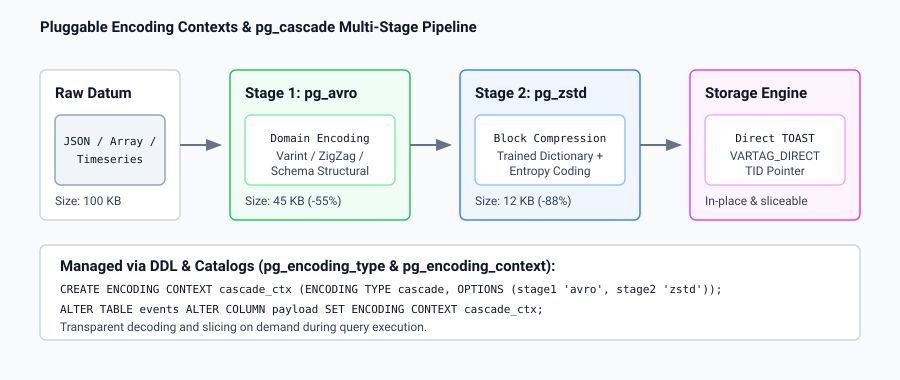

# PostgreSQL `one-with-everything`: Integrated Development Documentation

Welcome to the documentation for the **`one-with-everything`** branch of PostgreSQL (`postsql/postgres`).

This branch tracks upstream `master` (PostgreSQL 20devel) while unifying eight major engineering developments developed across specialized local branches into a single, cohesive, and battle-tested release.

---

## 1. Documentation Taxonomy & Navigation

The documentation is organized into four complementary analytical perspectives across all eight features:

- [**`what/`**](what/): Concise technical summaries of what each patch adds to PostgreSQL.
- [**`why/`**](why/): Architectural motivations, industry pain points, and technical benefits.
- [**`how/`**](how/): Practical user guides, SQL examples, configuration recipes, and CLI workflows.
- [**`tech/`**](tech/): Deep-dive internal design documents, catalog schemas, C APIs, and execution walk-throughs.
- [**`img/`**](img/): High-resolution vector diagrams and architectural schematics.

### Feature Matrix & Direct Links

| # | Feature / Patch Set | What | Why | How | Tech |
| :-: | :--- | :---: | :---: | :---: | :---: |
| **1** | **ReadyForQuery Hook & Protocol Extension** Extended `'Z'` wire protocol and C hook | [Read](what/01_ready_for_query_hook.md) | [Read](why/01_ready_for_query_hook.md) | [Read](how/01_ready_for_query_hook.md) | [Read](tech/01_ready_for_query_hook.md) |
| **2** | **pgbench Refactor & SQL Extension** Modular decomposition and SQL distributions | [Read](what/02_pgbench_refactor_and_extension.md) | [Read](why/02_pgbench_refactor_and_extension.md) | [Read](how/02_pgbench_refactor_and_extension.md) | [Read](tech/02_pgbench_refactor_and_extension.md) |
| **3** | **UNION DISTINCT ON & Recursive Pruning** Set operations with partial deduplication | [Read](what/03_union_distinct_on.md) | [Read](why/03_union_distinct_on.md) | [Read](how/03_union_distinct_on.md) | [Read](tech/03_union_distinct_on.md) |
| **4** | **Direct TOAST Storage Engine** Index-free TID addressing, DAG slicing & self-prune | [Read](what/04_direct_toast.md) | [Read](why/04_direct_toast.md) | [Read](how/04_direct_toast.md) | [Read](tech/04_direct_toast.md) |
| **5** | **Pluggable Encoding Contexts** DDL, catalogs, and chunk-level custom compression | [Read](what/05_encoding_contexts.md) | [Read](why/05_encoding_contexts.md) | [Read](how/05_encoding_contexts.md) | [Read](tech/05_encoding_contexts.md) |
| **6** | **Logical Decoding with TIDs & ROWID** PK-less logical replication, index-only rowid & prune CDC | [Read](what/06_logical_decoding_with_tids.md) | [Read](why/06_logical_decoding_with_tids.md) | [Read](how/06_logical_decoding_with_tids.md) | [Read](tech/06_logical_decoding_with_tids.md) |
| **7** | **Immediate Insert Visibility** Zero-latency ingestion and streaming visibility | [Read](what/07_immediate_insert_visibility.md) | [Read](why/07_immediate_insert_visibility.md) | [Read](how/07_immediate_insert_visibility.md) | [Read](tech/07_immediate_insert_visibility.md) |
| **8** | **TOAST Compression Modules** `pg_avro`, `pg_zstd`, `pg_lz4`, `pg_cascade` | [Read](what/08_toast_compression_modules.md) | [Read](why/08_toast_compression_modules.md) | [Read](how/08_toast_compression_modules.md) | [Read](tech/08_toast_compression_modules.md) |

---

## 2. Architectural Highlights & Visual Schematics

### Direct TOAST vs. Plain TOAST
Direct TOAST eliminates the B-Tree index lookup bottleneck for out-of-line storage, replacing OID indirection with direct physical TID addressing, flat arrays, and hierarchical DAGs with instant in-place dead tuple reclamation.

---

### Pluggable Encoding & Cascade Transformation Pipeline
The pluggable encoding context catalogs (`pg_encoding_type` and `pg_encoding_context`) allow custom domain serialization (Avro) to be chained directly into high-entropy dictionary compression (Zstandard), cutting physical storage footprint by up to 90%.

---

### State-Space Pruning in Recursive Queries
`UNION DISTINCT ON` enables true dynamic state-space pruning during recursive CTE iteration, replacing suboptimal paths and re-expanding exploration only when shorter routes are discovered.

---

### Logical Replication Without Primary Keys
`REPLICA IDENTITY ROWID` exposes the physical `ctid` as a virtual `.rowid` column, while target subscriber tables utilize index-only storage (0 bytes heap bloat) for fast $O(\log N)$ updates and deletes without table-scan penalties.

---

### Immediate Insert Visibility for Real-Time Streaming
Decouples read visibility from writer transaction commit boundaries, making inserted rows instantly queryable by concurrent sessions for sub-millisecond telemetry, logs, and queue processing.

---

### Rich ReadyForQuery Wire Protocol
Delivers session state flags (`'T'`, `'H'`, `'P'`, and commit LSN `'l'`) to connection poolers and proxies in $O(1)$ zero-round-trip wire packets.

---

## 3. Branch Verification Status

The `one-with-everything` branch has been built and tested with 100% pass rates across all test harnesses:

- **Core Regression**: `src/test/regress` (242/242 tests passed)
- **Contrib Modules**: `contrib` (All test suites passed, including `pg_avro`, `pg_zstd`, `pg_lz4`, `pg_cascade`, `amcheck`, `test_decoding`, `pgbench`)
- **Isolation Testing**: `src/test/isolation` (135/135 tests passed)
- **Client Binaries**: `src/bin` (All TAP suites passed, including `pgbench`, `pg_dump`, `pg_upgrade`, `psql`)
- **Recovery & Replication**: `src/test` (`recovery`, `subscription`, `authentication` passed)
- **PL & Interfaces**: `src/pl` (`plpgsql`) and `src/interfaces` (`ecpg` 66/66 passed)
