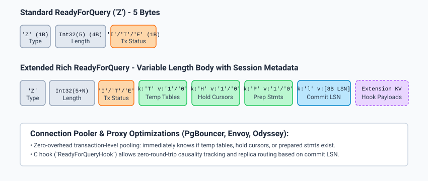

# Technical Design & Implementation: ReadyForQuery Hook

## 1. Architectural Overview

The `ready_for_query_hook` patch integrates directly into the PostgreSQL server's backend command completion sequence (`ReadyForQuery()` in `src/backend/tcop/dest.c`) and frontend communication protocols.



---

## 2. Core Wire Protocol Format

Under `ready_for_query_message = rich`, the ReadyForQuery message has variable length:

```text
+--------------+------------------+------------------+-----------------------------+
| Byte 0       | Bytes 1..4       | Byte 5           | Bytes 6 .. Length           |
| Message Type | Length (Int32)   | Tx Status        | Key-Value Payloads (TLV)    |
| 'Z'          | 5 + payload_len  | 'I' / 'T' / 'E'  | [u8 klen][key][u8 vlen][val]|
+--------------+------------------+------------------+-----------------------------+
```

Each key-value element is encoded as:
- `key_len` (`uint8`): Length of key in bytes (1..255).
- `key_bytes`: ASCII/UTF-8 key identifier.
- `val_len` (`uint8`): Length of value in bytes (0..255).
- `val_bytes`: Arbitrary binary or string payload.

---

## 3. Session State Tracking Mechanics

### 3.1 Temporary Tables (`'T'`)
- Maintained in `src/backend/catalog/namespace.c`.
- `has_temp_tables` flag is maintained dynamically during namespace creation, relation initialization, and teardown:
  - Set to `true` when a temporary relation or temporary namespace is created.
  - Cleared back to `false` when all temporary relations in the session are dropped (checked via `HasTempTables()` or during `DISCARD TEMP` / `DISCARD ALL`).

### 3.2 Held Cursors (`'H'`)
- Maintained in `src/backend/utils/mmgr/portalmem.c`.
- An $O(1)$ global counter `ActiveHoldCursorsCount` is incremented whenever a portal is marked with `CURSOR_OPT_HOLD` and successfully persists past transaction commit.
- Decremented on portal drop, closure, or session cleanup.
- Flag `'H'` is `'1'` if `ActiveHoldCursorsCount > 0`, else `'0'`.

### 3.3 Prepared Statements (`'P'`)
- Maintained in `src/backend/commands/prepare.c`.
- Checked via `HasPreparedStatements()`, which inspects whether the session's prepared statement hash table (`prepared_queries`) contains active entries.

### 3.4 Commit LSN (`'l'`)
- Captured from `src/backend/access/transam/xact.c` during `CommitTransaction()`.
- Extracted via `GetLastTransactionCommitLSN()`.
- Encoded as 8 bytes in big-endian network byte order (`uint64`).

---

## 4. C Hook Architecture (`ReadyForQueryHook`)

### Definition in `src/include/tcop/dest.h`
```c
typedef void (*ready_for_query_hook_type) (StringInfo buf);
extern PGDLLIMPORT ready_for_query_hook_type ReadyForQueryHook;

extern bool ready_for_query_has_key(StringInfo buf, const char *key);
extern void ready_for_query_append_kv(StringInfo buf,
                                      const char *key, uint8 key_len,
                                      const char *val, uint8 val_len);
```

### Hook Invocation Pipeline in `src/backend/tcop/dest.c`
```c
void
ReadyForQuery(CommandDest dest)
{
    StringInfoData buf;

    pq_beginmessage(&buf, 'Z');
    pq_sendbyte(&buf, TransactionBlockStatusCode());

    if (ready_for_query_message == RFQ_RICH)
    {
        /* Append built-in flags */
        ready_for_query_append_kv(&buf, "T", 1, HasTempTables() ? "1" : "0", 1);
        ready_for_query_append_kv(&buf, "H", 1, ActiveHoldCursorsCount > 0 ? "1" : "0", 1);
        ready_for_query_append_kv(&buf, "P", 1, HasPreparedStatements() ? "1" : "0", 1);

        /* Append 8-byte commit LSN */
        XLogRecPtr commit_lsn = GetLastTransactionCommitLSN();
        uint64 lsn_nbo = pg_hton64((uint64) commit_lsn);
        ready_for_query_append_kv(&buf, "l", 1, (const char *) &lsn_nbo, sizeof(lsn_nbo));

        /* Invoke extension hooks */
        if (ReadyForQueryHook)
            ReadyForQueryHook(&buf);
    }

    pq_endmessage(&buf);
}
```

---

## 5. Client Library Updates (`libpq`)

1. **`fe-protocol3.c`**:
   The standard libpq packet parser for `'Z'` expects at least 1 byte of payload (the transaction status). It was updated to read the initial byte and safely skip any trailing extension bytes up to the packet length, guaranteeing forward and backward compatibility.
2. **`fe-trace.c`**:
   Updated to parse and print trailing key-value pairs during protocol tracing (`PQtrace`) instead of issuing a packet length mismatch error.
