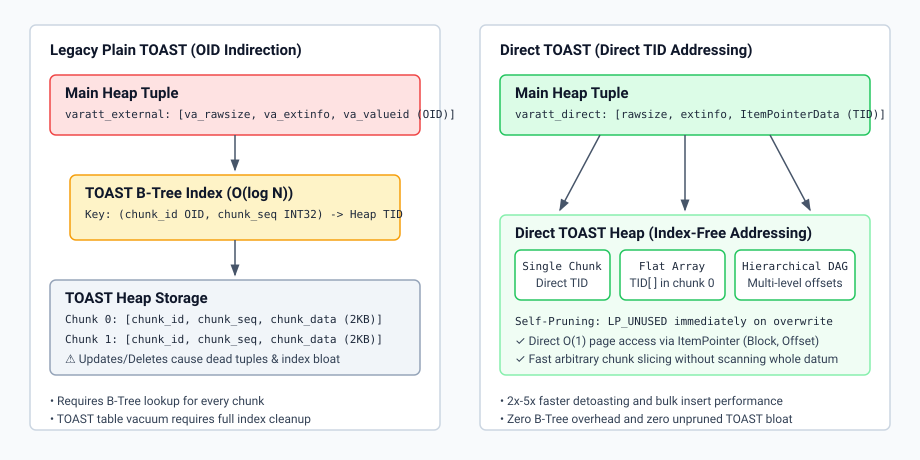

# Technical Design & Implementation: Direct TOAST

## 1. Physical Pointer Format (`struct varatt_direct`)

Direct TOAST introduces `VARTAG_DIRECT` in `src/include/varatt.h`:

```c
struct varatt_direct {
    uint8       va_header;      /* Tag = VARTAG_DIRECT (0x03) */
    uint8       va_tag_ext;     /* Sub-tag: SINGLE, FLAT, or DAG */
    uint16      va_rawsize_hi;  /* High bits of uncompressed size */
    uint32      va_rawsize_lo;  /* Low 32 bits of uncompressed size (up to 1GB) */
    uint32      va_extinfo;     /* Compression method + encoding context ID */
    ItemPointerData va_chunk_tid; /* Physical TID (BlockNumber, OffsetNumber) */
};
```

Unlike Plain TOAST (`varatt_external`), which stores a 32-bit chunk ID OID, `varatt_direct` points directly to the physical storage location on disk.

---

## 2. Direct TOAST Physical Relation Schema (6 Columns)

In Direct TOAST, the underlying TOAST relation (`pg_toast_<oid>`) uses a 6-column physical schema defined in `src/backend/catalog/toasting.c`:

| Attr # | Column Name | Type | Description |
| :-: | :--- | :--- | :--- |
| **1** | `chunk_id` | `OID` / `INT4` | Legacy OID identifier (kept for Plain TOAST compatibility; `NULL` for Direct TOAST tuples). |
| **2** | `chunk_seq` | `INT4` | Logical chunk sequence number for ordering and integrity checks. |
| **3** | `chunk_data` | `BYTEA` | The raw or compressed chunk payload. |
| **4** | `chunk_tids` | `TID[]` | Array of child chunk TIDs for Flat multi-chunk roots and DAG interior nodes. |
| **5** | `chunk_tid_offsets` | `INT8[]` | Cumulative byte offset boundaries corresponding to each child TID for binary-search slicing. |
| **6** | **`chunk_ectx_id`** | **`OID`** | **The Compression Context OID** used to encode this chunk. Enables self-describing chunk decompression. |

The partial unique index on the TOAST table is defined as `WHERE chunk_id IS NOT NULL`, allowing Direct TOAST chunks (where `chunk_id` is NULL) to bypass index insertion and index maintenance entirely.

---

## 3. Three-Tier Storage Engine



### Tier 1: Single Chunk (`VARTAG_DIRECT_SINGLE`)
- Used for external attributes that fit entirely within a single TOAST block (typically $\le 2000$ bytes).
- `va_chunk_tid` points directly to the page item containing the data. Reading requires exactly **1 buffer read** and **0 index lookups**.
- Encoded with `chunk_ectx_id` recorded directly in the chunk tuple.

### Tier 2: Flat Array (`VARTAG_DIRECT_FLAT`)
- Used for attributes requiring 2 to ~32 chunks ($\le 64\text{KB}$).
- The root chunk addressed by `va_chunk_tid` contains a flat array header:
  ```c
  typedef struct DirectToastFlatHeader {
      int32           nchunks;
      ItemPointerData chunk_tids[FLEXIBLE_ARRAY_MEMBER];
  } DirectToastFlatHeader;
  ```
- Reading any chunk $K$ is an immediate $O(1)$ dereference: `header->chunk_tids[K]`.
- Child chunks and root chunk each carry their respective `chunk_ectx_id`.

### Tier 3: Hierarchical DAG (`VARTAG_DIRECT_DAG`)
- Used for large datums (up to 1GB).
- Chunks form an $N$-ary balanced tree.
- Internal index chunks store arrays of:
  ```c
  typedef struct DirectToastDagEntry {
      uint32          byte_offset; /* Cumulative starting byte offset */
      ItemPointerData chunk_tid;   /* Pointer to child index or leaf */
  } DirectToastDagEntry;
  ```
- Fast binary-search slicing: finding byte offset $B$ traverses $\log_N(\text{size})$ branch nodes directly to the target block.

---

## 4. In-Place Self-Pruning Mechanics (`pruneheap.c`)

In `src/backend/access/heap/pruneheap.c`:
1. When a heap tuple with an external pointer is pruned or frozen:
2. If `direct_toast_self_prune` is enabled and tag is `VARTAG_DIRECT`:
3. The engine fetches `va_chunk_tid`, opens the TOAST relation buffer, and marks the line pointer directly as `LP_UNUSED`.
4. If it is a Flat or DAG root, child pointers are recursively pruned to `LP_UNUSED`.
5. Because there is no B-Tree index referencing these TIDs, the space is immediately available for subsequent tuple insertions.

---

## 5. In-Place Upgrade (`pg_ensure_direct_toast`)

In `src/backend/catalog/toasting.c`:
- `pg_ensure_direct_toast(Oid relid)`:
  1. Acquires `AccessExclusiveLock` on the target relation.
  2. Modifies `pg_class.reloptions` of the TOAST table to set `toast_flavour = 'direct'`.
  3. Upgrades the TOAST table schema to add missing columns (`chunk_tids`, `chunk_tid_offsets`, and `chunk_ectx_id`) if transitioning from a 3-column legacy table.
  4. Changes the TOAST table's unique index to a partial index (`WHERE chunk_id IS NOT NULL`).
  5. The unified detoasting pipeline handles legacy OID pointers and new direct TID pointers simultaneously.
