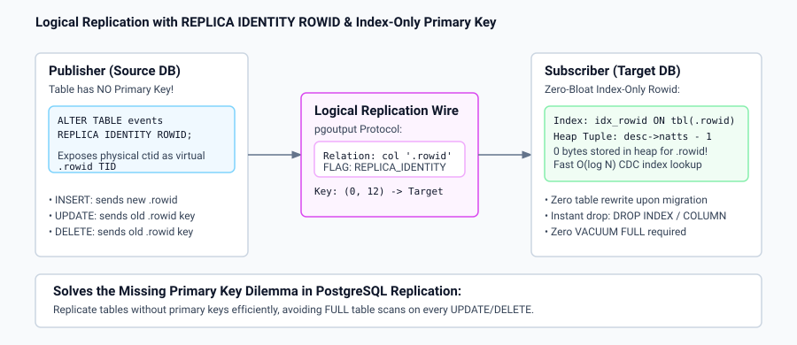

# Technical Design & Implementation: Logical Decoding with TIDs & ROWID

## 1. TID Exposure in Logical Decoding

In `src/backend/replication/logical/decode.c`:
1. When processing `XLOG_HEAP_INSERT`, `XLOG_HEAP_UPDATE`, and `XLOG_HEAP_DELETE` records, the physical `ItemPointerData` (`ctid`) is extracted directly from the WAL record header.
2. In `reorderbuffer.c`, `ReorderBufferChange` preserves `tuple_tid` for the change.
3. In `test_decoding.c`, when `include_tids` is enabled, the formatted change prepends `(tid[block,offset])` to the tuple payload.

---

## 2. REPLICA IDENTITY ROWID Architecture

### 2.1 Catalog and Parser Additions
- Added `REPLICA_IDENTITY_ROWID ('r')` in `src/include/catalog/pg_class.h`.
- `gram.y` parses `ALTER TABLE ... REPLICA IDENTITY ROWID;`.
- Tables marked with `'r'` permit `UPDATE` and `DELETE` without requiring an explicit physical primary key.

### 2.2 Wire Protocol Serialization (`proto.c` & `pgoutput.c`)
During logical replication streaming:
1. **Relation Message**:
   Appends a virtual column named `.rowid` of type `TIDOID` flagged with `LOGICALREP_IS_REPLICA_IDENTITY` as the trailing column of the relation schema.
2. **Data Messages**:
   - `INSERT`: Appends the new `ctid` as `.rowid`.
   - `UPDATE`: Sends the old `ctid` in the `KeyTuple` and the new `ctid` in the `NewTuple`.
   - `DELETE`: Sends the old `ctid` in the `KeyTuple` (even when `REPLICA IDENTITY FULL` tuple logging is disabled).

---

## 3. Index-Only Primary Key Mechanics (`heaptuple.c` & `heapam.c`)

### 3.1 Heap Tuple Shortening (`RelationIsIndexOnlyRowid`)
On subscriber tables configured with `index_only_rowid = true`:
- The relation cache detects that the trailing attribute is `.rowid` of type `tid` with an index present (`RelationIsIndexOnlyRowid(relation) == true`).
- `heapam_tuple_insert`, `heapam_tuple_update`, and `heap_multi_insert` construct disk tuples using `desc->natts - 1` columns.
- The `.rowid` column is **never written to disk pages**, consuming 0 bytes of heap storage.

### 3.2 Index Maintenance
- The full tuple slot (`TupleTableSlot`), which contains `.rowid`, is passed to `ExecInsertIndexTuples()`.
- The index on `.rowid` is fully populated, allowing $O(\log N)$ B-Tree lookups during CDC apply.
- HOT (Heap-Only Tuple) updates are disabled for index-only rowid tables to ensure index pointers always remain valid.

---

## 4. Prune Record Decoding (`XLOG_HEAP2_PRUNE`)

### 4.1 WAL Logging in `pruneheap.c`
When `logical_decoding_prune_records = true` and the table has logical replication active:
- `log_heap_prune_and_freeze()` sets `REGBUF_KEEP_DATA` on the heap buffer to retain item pointer details in WAL even when a Full Page Image (FPI) is written.

### 4.2 Decoding in `decode.c`
- `DecodePrune()` intercepts `XLOG_HEAP2_PRUNE_ON_ACCESS`, `XLOG_HEAP2_PRUNE_VACUUM_SCAN`, and `XLOG_HEAP2_PRUNE_VACUUM_CLEANUP`.
- Deserializes dead, unused, and redirected line pointer offsets via `heap_xlog_deserialize_prune_and_freeze()`.
- Invokes the output plugin's `prune_cb` callback with `LogicalDecodePruneData`.
