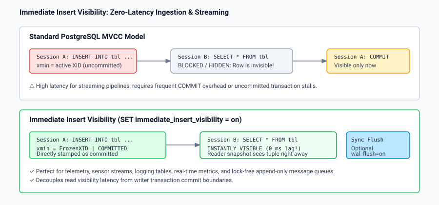

# What: Immediate Insert Visibility and Synchronous WAL Flush

## Overview

The `immediate_insert_visibility` feature allows applications to bypass standard MVCC snapshot visibility delays for inserted rows, making newly inserted tuples globally visible to all concurrent transactions immediately upon execution of the `INSERT` statement:

1. **Immediate Global Insert Visibility (`immediate_insert_visibility = on`)**:
   - In standard PostgreSQL MVCC, an inserted tuple is stamped with the inserting transaction's active `XID`. Concurrent transactions cannot see the tuple until the inserting transaction successfully commits (`COMMIT`).
   - With `immediate_insert_visibility = on`:
     - The tuple's header is stamped as already committed at the moment of insertion (`FrozenTransactionId` or `HEAP_XMIN_COMMITTED | HEAP_XMIN_FROZEN`).
     - Concurrent backends reading the table see the new tuple instantly without waiting for writer transaction commit boundaries.
     - Unlocks true sub-millisecond, lockless producer-consumer queuing, high-throughput metrics ingestion, and live telemetry in pure SQL.

2. **Synchronous Insert WAL Flushing (`immediate_insert_wal_flush = on`)**:
   - Controls whether the WAL record generated by the insert is immediately flushed to disk before the insert call returns.
   - When `immediate_insert_wal_flush = on`: guarantees durability across server crashes immediately upon statement completion, even if the surrounding user transaction remains open.
   - When `immediate_insert_wal_flush = off`: WAL records are buffered in shared memory and flushed asynchronously by standard WAL writer background processes, maximizing insert throughput.

3. **Isolation and Concurrency Guarantees**:
   - `UPDATE` and `DELETE` operations continue to use standard PostgreSQL MVCC rules, preventing write-write conflicts.
   - Ideal for append-only tables (time-series, audit trails, event sourcing, IoT sensors, and job queue tables).
