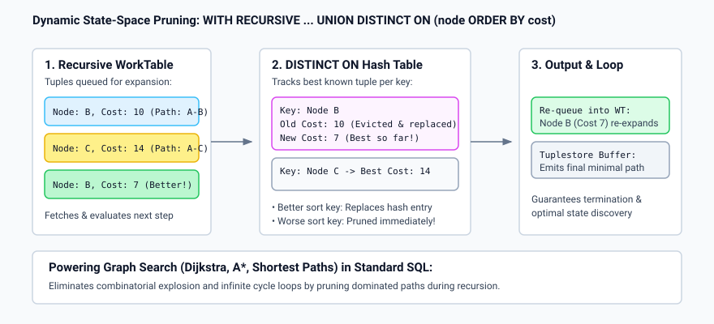

# Why: Rationale for UNION DISTINCT ON

## Motivation and Industry Context

PostgreSQL users have long loved `SELECT DISTINCT ON (col1, col2) ... ORDER BY col1, col2, tiebreaker` because it elegantly solves "greatest-n-per-group" queries without needing nested window functions (`ROW_NUMBER() OVER (...)`).

However, before this patch, duplicate elimination on a subset of columns was strictly limited to single `SELECT` statements:
1. **Set Operations Lacked Partial Deduplication**:
   When combining datasets from two or more queries using `UNION`, PostgreSQL only supported `UNION` (which deduplicates across *all* columns) or `UNION ALL` (which keeps all rows). If a developer needed to combine two streams and keep only the latest record per customer ID, they had to wrap the entire `UNION ALL` in an outer subquery:
   ```sql
   SELECT DISTINCT ON (customer_id) *
   FROM (
       SELECT customer_id, updated_at, status FROM live_events
       UNION ALL
       SELECT customer_id, updated_at, status FROM archive_events
   ) sub
   ORDER BY customer_id, updated_at DESC;
   ```
   This forced redundant query planning layers, obscured optimizer statistics, and prevented effective index pushdowns.

2. **The "Shortest-Path" and Recursive Search Bottleneck in SQL**:
   In recursive CTEs (`WITH RECURSIVE`), standard `UNION` only eliminates identical rows across all attributes. In graph traversal, route optimization, Dijkstra's algorithm, and dynamic programming, one needs to prune paths:
   - If node $V$ has already been reached with cost 10, exploring a path that reaches node $V$ with cost 15 is redundant and causes combinatorial explosion or infinite cycles.
   - Conversely, if a path reaches node $V$ with cost 7, the previous entry must be replaced and the frontier re-expanded.
   Previously, solving shortest-path or state-space search in pure SQL required cumbersome array tracking or procedural PL/pgSQL loops that scaled poorly.

## How This Feature Solves the Problem



1. **First-Class SQL Expressiveness**:
   Writing `SELECT ... UNION DISTINCT ON (customer_id ORDER BY updated_at DESC) SELECT ...` makes the developer's intent concise, direct, and readable.

2. **Optimizer Freedom**:
   The planner can choose between `HashAggregate` (when no sorting is required) and `Sort -> Unique` execution paths directly on set operations, avoiding the subquery overhead.

3. **Graph Search and Shortest Paths in Pure SQL**:
   By adding dynamic pruning to recursive CTEs:
   ```sql
   WITH RECURSIVE path_finder AS (
       SELECT target_node, cost, ARRAY[target_node] AS path FROM edges WHERE source_node = 'A'
       UNION DISTINCT ON (target_node ORDER BY cost ASC)
       SELECT e.target_node, p.cost + e.weight, p.path || e.target_node
       FROM path_finder p JOIN edges e ON p.target_node = e.source_node
   )
   SELECT * FROM path_finder;
   ```
   PostgreSQL executes true state-space pruning natively in C inside the executor node, replacing suboptimal paths and re-expanding only when cheaper routes are discovered. This runs orders of magnitude faster than iterative PL/pgSQL solutions.
