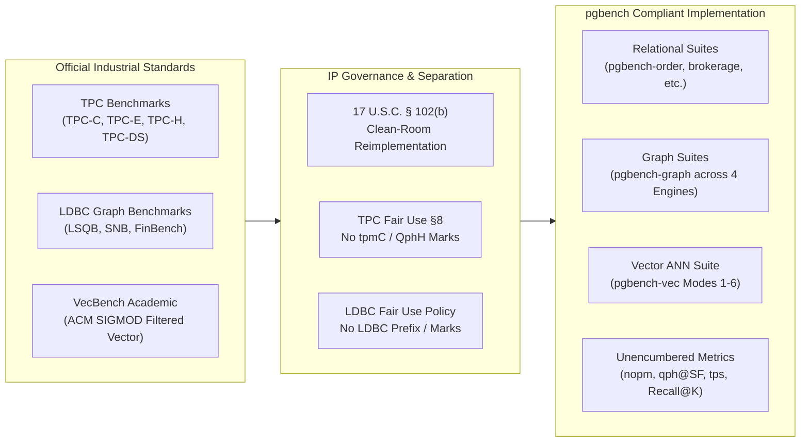
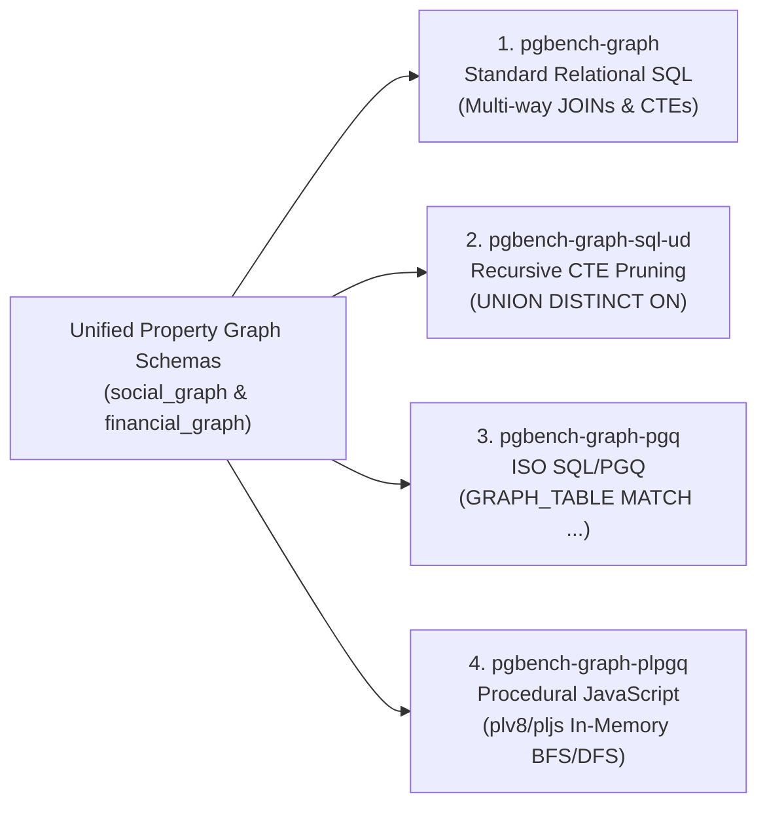

# Benchmark Workload Inspiration, Domain Mapping, and IP Compliance

<!-- go/g3mark-in-g3doc -->
<!-- freshness: { owner: 'hannuk' reviewed: '2026-10-27' } -->

[TOC]

---

## 1. Overview and Principles of "Inspiration" vs. "Certification"

The benchmark workload suites included with `pgbench` and `pgbench4perffarm` are independent, clean-room engineering benchmarks designed for database kernel development, regression triage, hardware evaluation, and continuous integration testing.

A foundational distinction exists under intellectual property law and governance policies between:

1. **Official Certified Benchmarks**: Proprietary benchmarks developed, governed, audited, and published by formal industry consortia—specifically the Transaction Processing Performance Council (TPC) and the Graph Data Council (LDBC). Official benchmark results require 100% adherence to full council specifications (including strict ACID test proofs, 60-day storage and pricing disclosures, official client drivers, and full disclosure reports), independent auditor verification, and formal council approval.
2. **Independent "Inspired-by" Research Suites**: Clean-room open-source engineering implementations that adopt well-known conceptual transaction processing, analytical decision support, graph traversal, and vector search patterns to simulate realistic database workloads. Under United States copyright law (17 U.S.C. § 102(b)), copyright protection does not extend to ideas, procedures, systems, methods of operation, concepts, principles, or mathematical formulas. All schemas, data generators, transaction procedures, and queries in `pgbench` are 100% original clean-room implementations written in native SQL and C without copying third-party proprietary generator code (such as TPC `dbgen`, `tpch-kit`, or `dsdgen`, or LDBC Java/Scala `datagen`).



To guarantee compliance with trademark, unfair competition, and fair-use governance policies (including TPC Policies v7.x Section 8 and the LDBC Byelaws & Trademark/Fair Use Policy):

- **No Trademarked Suite Names**: Suite names and directory paths avoid using registered trademarks (such as `TPC-C`, `TPC-E`, `TPC-H`, `TPC-DS`, `LDBC`, or `VecBench`). Instead, suites are named using clear, domain-descriptive business terminology (`pgbench-banking`, `pgbench-order`, `pgbench-brokerage`, `pgbench-analytics`, `pgbench-retail`, `pgbench-htap`, `pgbench-graph`, `pgbench-vec`).
- **No Trademarked Metric Reporting**: Restrictive, audited metric titles such as `tpmC` and `QphH` are never emitted. Instead, `pgbench` reports standard unencumbered physical rate units:
  - `nopm`: New Orders Per Minute (standard industry throughput metric for wholesale order entry, aligned with tools such as HammerDB and Sysbench).
  - `qph@SF`: Queries Per Hour at Scale Factor (standard rate unit for analytical decision support queries).
  - `tps`: Transactions Per Second for transactional and graph workloads.
  - `Recall@K`: Exact ratio of retrieved ground-truth neighbors for vector search.
- **Mathematical Terminology for Graph Primitives**: Generator functions avoid consortium acronyms (`ldbc_*`) and are named after the underlying mathematical algorithms:
  - `community_correlated_edge`: Stochastic block model with attribute homophily and power-law degree distributions.
  - `burst_timestamp`: Multi-modal Gaussian temporal clustering modeling traffic spikes and bursts.
- **Self-Contained In-Database Initialization**: All suites generate initial synthetic data entirely in the database using `generate_series()` and deterministic pseudo-random functions from the `contrib/pgbench` extension (`pgbench.random`, `pgbench.random_vector`, `pgbench.planted_vector`, `pgbench.community_correlated_edge`, etc.). No external generator binaries, flat files, or unverified dependencies are required.

---

## 2. Master Correspondence Mapping Table (45 Elements)

The following table provides the exact correspondence between legacy or inspired-by identifiers, official specification concepts, compliant identifiers implemented in `pgbench4perffarm`, component scope, and legal rationale:

| # | Current / Legacy Identifier | "Inspired-by" Specification | Compliant Identifier / Path | Component Type | Rationale & Legal Justification |
|---|:---|:---|:---|:---|:---|
| **M1** | `"tpmC"` (in `engine.c`, `logdb.c`, JSON report) | TPC-C (`tpmC`) | `"nopm"` (New Orders Per Min) or `"orders_per_sec"` | Emitted Metric / JSON Key | **Eliminates direct trademark infringement.** `tpmC` is a registered trademark of the TPC. `nopm` is standard industry terminology (HammerDB, Sysbench). |
| **M2** | `"QphH"` (in `engine.c`, `logdb.c`, JSON report) | TPC-H (`QphH`) | `"qph"` (Queries Per Hour) or `"qpm"` (Queries Per Min) | Emitted Metric / JSON Key | **Eliminates direct trademark infringement.** `QphH` is a registered trademark of the TPC. `qph` is a generic rate unit. |
| **F1** | `pgbench.ldbc_correlated_edge(...)` | LDBC SNB Data Generator | `pgbench.community_correlated_edge(...)` | PostgreSQL C Function (`contrib/pgbench`) | **Eliminates trademark infringement.** Removes mark `LDBC`. Accurately describes community homophily stochastic block model. |
| **F2** | `pgbench_ldbc_correlated_edge(...)` | LDBC SNB Data Generator | `pgbench.pgbench_community_correlated_edge(...)` | PostgreSQL C Function (`contrib/pgbench`) | Alias cleanup. |
| **F3** | `pgbench.ldbc_flashmob_ts(...)` | LDBC SNB Flashmob Generator | `pgbench.burst_timestamp(...)` | PostgreSQL C Function (`contrib/pgbench`) | **Eliminates trademark infringement.** Removes mark `LDBC`. Accurately describes multi-modal Gaussian temporal clustering. |
| **F4** | `pgbench_ldbc_flashmob_ts(...)` | LDBC SNB Flashmob Generator | `pgbench.pgbench_burst_timestamp(...)` | PostgreSQL C Function (`contrib/pgbench`) | Alias cleanup. |
| **K1** | `ldbc_correlated_edge(...)` (client keyword) | LDBC SNB | `community_correlated_edge(...)` | `pgbench` Grammar (`exprparse.y`, `script.c`) | Removes `ldbc` keyword from client scripting language. |
| **K2** | `ldbc_flashmob_ts(...)` (client keyword) | LDBC SNB | `burst_timestamp(...)` | `pgbench` Grammar (`exprparse.y`, `script.c`) | Removes `ldbc` keyword from client scripting language. |
| **E1** | `PGBENCH_LDBC_CORRELATED_EDGE` | LDBC SNB | `PGBENCH_COMMUNITY_CORRELATED_EDGE` | Internal C Enum (`src/bin/pgbench/pgbench.h`) | Internal clean-room refactoring. |
| **E2** | `PGBENCH_LDBC_FLASHMOB_TS` | LDBC SNB | `PGBENCH_BURST_TIMESTAMP` | Internal C Enum (`src/bin/pgbench/pgbench.h`) | Internal clean-room refactoring. |
| **X1** | `pgbench_ldbc_correlated_edge_sql` | LDBC SNB | `pgbench_community_correlated_edge_sql` | Exported C Symbol (`exports.ld`) | Shared library symbol table cleanup. |
| **X2** | `pgbench_ldbc_flashmob_ts_sql` | LDBC SNB | `pgbench_burst_timestamp_sql` | Exported C Symbol (`exports.ld`) | Shared library symbol table cleanup. |
| **S1** | `workloads/pgbench-b/` | Wisconsin / TPC-B | `workloads/pgbench-banking/` | Workload Suite Directory | Suffix `-b` is low risk, but `pgbench-banking` is 100% descriptive and avoids single-letter ambiguity. |
| **S2** | `workloads/pgbench-c/` | TPC-C | `workloads/pgbench-order/` | Workload Suite Directory | Eliminates TPC shorthand. Descriptively indicates order-entry wholesale workload. |
| **S3** | `workloads/pgbench-e/` | TPC-E | `workloads/pgbench-brokerage/` | Workload Suite Directory | Eliminates TPC shorthand. Descriptively indicates financial brokerage OLTP. |
| **S4** | `workloads/pgbench-h/` | TPC-H | `workloads/pgbench-analytics/` | Workload Suite Directory | Eliminates TPC shorthand. Descriptively indicates decision support analytical queries. |
| **S5** | `workloads/pgbench-ds/` | TPC-DS | `workloads/pgbench-retail/` | Workload Suite Directory | Eliminates TPC shorthand. Descriptively indicates multi-channel star-schema retail decision support. |
| **S6** | `workloads/pgbench-htap/` | CH-benCHmark | `workloads/pgbench-htap/` | Workload Suite Directory | **Compliant.** Generic industry acronym (Hybrid Transactional/Analytical Processing). |
| **S7** | `workloads/pgbench-graph/` | LDBC | `workloads/pgbench-graph/` | Workload Suite Directory | **Compliant.** Generic industry domain name. |
| **S8** | `workloads/pgbench-vec/` | VecBench | `workloads/pgbench-vec/` | Workload Suite Directory | **Compliant.** Generic industry domain name. |
| **G1** | `pgbench_ldbc_lsqb.sql` | LDBC LSQB | `pgbench_graph_subgraph.sql` | SQL Script (`pgbench-graph`) | Removes `ldbc` and `lsqb`. Descriptively indicates Labelled Subgraph pattern matching. |
| **G2** | `pgbench_ldbc_snb_is.sql` | LDBC SNB Interactive Short | `pgbench_graph_social_short.sql` | SQL Script (`pgbench-graph`) | Removes `ldbc` and `snb`. Descriptively indicates 1-hop / 2-hop short read traversals. |
| **G3** | `pgbench_ldbc_snb_ic.sql` | LDBC SNB Interactive Complex | `pgbench_graph_social_complex.sql` | SQL Script (`pgbench-graph`) | Removes `ldbc` and `snb`. Descriptively indicates complex pattern matching and friend scoring. |
| **G4** | `pgbench_ldbc_snb_iu.sql` | LDBC SNB Interactive Updates | `pgbench_graph_social_insert.sql` | SQL Script (`pgbench-graph`) | Removes `ldbc` and `snb`. Descriptively indicates streaming vertex/edge inserts. |
| **G5** | `pgbench_ldbc_snb_id.sql` | LDBC SNB Interactive Deletes | `pgbench_graph_social_delete.sql` | SQL Script (`pgbench-graph`) | Removes `ldbc` and `snb`. Descriptively indicates cascading vertex/edge deletes. |
| **G6** | `pgbench_ldbc_snb_bi.sql` | LDBC SNB Business Intelligence | `pgbench_graph_social_bi.sql` | SQL Script (`pgbench-graph`) | Removes `ldbc` and `snb`. Descriptively indicates phased batch BI analytical graph queries. |
| **G7** | `pgbench_ldbc_finbench.sql` | LDBC FinBench | `pgbench_graph_financial.sql` | SQL Script (`pgbench-graph`) | Removes `ldbc` and `finbench`. Descriptively indicates financial transaction graph cycles. |
| **G8** | `pgbench_ldbc_graphalytics.sql` | LDBC Graphalytics | `pgbench_graph_algorithms.sql` | SQL Script (`pgbench-graph`) | Removes `ldbc` and `graphalytics`. Descriptively indicates global graph algorithms (BFS, WCC, PageRank, LCC). |
| **G9** | `pgbench_ldbc_sql_ud_*.sql` (8 files) | LDBC (SQL_UD variants) | `pgbench_graph_sql_ud_*.sql` | SQL Scripts (`pgbench-graph-sql-ud`) | Clean rename mirroring G1–G8 with engine qualifier `_sql_ud_`. |
| **G10** | `pgbench_ldbc_pgq_*.sql` (8 files) | LDBC (SQL/PGQ variants) | `pgbench_graph_pgq_*.sql` | SQL Scripts (`pgbench-graph-pgq`) | Clean rename mirroring G1–G8 with engine qualifier `_pgq_`. |
| **G11** | `pgbench_ldbc_plpgq_*.sql` (8 files) | LDBC (plPGQ variants) | `pgbench_graph_plpgq_*.sql` | SQL Scripts (`pgbench-graph-plpgq`) | Clean rename mirroring G1–G8 with engine qualifier `_plpgq_`. |
| **J1** | `lsqb.pgbench.json` | LDBC LSQB | `subgraph.pgbench.json` | JSON Config Manifest | Removes council benchmark acronym from configuration filename. |
| **J2** | `snb_interactive.pgbench.json` | LDBC SNB Interactive | `social_interactive.pgbench.json` | JSON Config Manifest | Removes council benchmark acronym from configuration filename. |
| **J3** | `snb_bi.pgbench.json` | LDBC SNB BI | `social_bi.pgbench.json` | JSON Config Manifest | Removes council benchmark acronym from configuration filename. |
| **J4** | `finbench.pgbench.json` | LDBC FinBench | `financial.pgbench.json` | JSON Config Manifest | Removes council benchmark acronym from configuration filename. |
| **J5** | `graphalytics.pgbench.json` | LDBC Graphalytics | `algorithms.pgbench.json` | JSON Config Manifest | Removes council benchmark acronym from configuration filename. |
| **D1** | `CREATE PROPERTY GRAPH snb_graph` | LDBC SNB | `CREATE PROPERTY GRAPH social_graph` | SQL/PGQ DDL (`pgbench_graph_pgq_schema.sql`) | Clean DDL object naming without council marks. |
| **D2** | `CREATE PROPERTY GRAPH finbench_graph` | LDBC FinBench | `CREATE PROPERTY GRAPH financial_graph` | SQL/PGQ DDL (`pgbench_graph_pgq_schema.sql`) | Clean DDL object naming without council marks. |
| **D3** | `CREATE FUNCTION snb_graph()` | LDBC SNB | `CREATE FUNCTION social_graph()` | plPGQ Function DDL | Clean DDL function naming. |
| **D4** | `CREATE FUNCTION finbench_graph()` | LDBC FinBench | `CREATE FUNCTION financial_graph()` | plPGQ Function DDL | Clean DDL function naming. |
| **T1** | `pgbench-c` (Perffarm test name) | TPC-C | `pgbench-order` | Perffarm Test Matrix (`test_matrix.json`) | Unambiguous domain identifier in Perffarm dashboard and regression views. |
| **T2** | `pgbench-e` (Perffarm test name) | TPC-E | `pgbench-brokerage` | Perffarm Test Matrix (`test_matrix.json`) | Unambiguous domain identifier in Perffarm dashboard and regression views. |
| **T3** | `pgbench-h` (Perffarm test name) | TPC-H | `pgbench-analytics` | Perffarm Test Matrix (`test_matrix.json`) | Unambiguous domain identifier in Perffarm dashboard and regression views. |
| **T4** | `pgbench-ds` (Perffarm test name) | TPC-DS | `pgbench-retail` | Perffarm Test Matrix (`test_matrix.json`) | Unambiguous domain identifier in Perffarm dashboard and regression views. |
| **T5** | `pgbench-graph-lsqb` | LDBC LSQB | `pgbench-graph-subgraph` | Perffarm Test Matrix (`test_matrix.json`) | Descriptive test name in regression views. |
| **T6** | `pgbench-graph-snb-interactive` | LDBC SNB Interactive | `pgbench-graph-social-interactive` | Perffarm Test Matrix (`test_matrix.json`) | Descriptive test name in regression views. |
| **T7** | `pgbench-graph-snb-bi` | LDBC SNB BI | `pgbench-graph-social-bi` | Perffarm Test Matrix (`test_matrix.json`) | Descriptive test name in regression views. |
| **T8** | `pgbench-graph-finbench` | LDBC FinBench | `pgbench-graph-financial` | Perffarm Test Matrix (`test_matrix.json`) | Descriptive test name in regression views. |
| **T9** | `pgbench-graph-graphalytics` | LDBC Graphalytics | `pgbench-graph-algorithms` | Perffarm Test Matrix (`test_matrix.json`) | Descriptive test name in regression views. |
| **P1** | `001_pgbench_with_server.pl` | TPC-C / TPC-H | Asserts `nopm` and `qph` | Perl TAP Test File | Prevents test suite failure upon metric rename. |
| **P2** | `contrib/pgbench/sql/pgbench.sql` & `.out` | LDBC | Calls `community_correlated_edge` & `burst_timestamp` | C Extension Test Suite | Prevents `make check` failure upon SQL function rename. |

---

## 3. Relational Benchmark Suites

### 3.1 `pgbench-banking` (Modernized Stored-Procedure Banking OLTP)

- **Lineage and Context**: Derived from the classic Wisconsin Benchmark and pgbench's original embedded banking transactions (`-b tpcb-like`), with historical lineage tracing to the debit-credit transactional concepts originally formalized in TPC-B (which was formally retired by the TPC in 1995). Modernized in `pgbench4perffarm` to execute all operational logic inside server-side PL/pgSQL stored procedures.
- **Architectural Advantage**: By moving debit, credit, balance verification, and audit logging into server-side stored procedures (`CALL pgbench_banking_transaction(...)`), multi-roundtrip network latency between client and server is completely eliminated. The workload exercises PostgreSQL's procedure execution engine, tuple-level locking, and WAL write paths under default autocommit mode without client-side `BEGIN` / `COMMIT` roundtrip overhead.
- **Mathematical Invariant & Audit Balancing**:
  In accordance with the Wisconsin and debit-credit specifications, the database enforces a strict physical conservation of money across all accounts, tellers, and branches:
  $$\sum_{a \in \text{accounts}} \text{abalance}_a = \sum_{t \in \text{tellers}} \text{tbalance}_t = \sum_{b \in \text{branches}} \text{bbalance}_b = \sum_{h \in \text{history}} \text{delta}_h$$
  At the conclusion of a benchmark run, the integrity of the database is verified by executing an audit balance check:
  ```sql
  SELECT (SELECT sum(bbalance) FROM pgbench_branches) - (SELECT sum(tbalance) FROM pgbench_tellers) AS branch_teller_diff,
         (SELECT sum(bbalance) FROM pgbench_branches) - (SELECT sum(abalance) FROM pgbench_accounts) AS branch_account_diff,
         (SELECT sum(bbalance) FROM pgbench_branches) - (SELECT sum(delta) FROM pgbench_history)    AS branch_history_diff;
  ```
  All differences must evaluate exactly to zero. Because there is only 1 branch row and 10 teller rows per scale factor unit, concurrent updates to branches and tellers create extreme row-level lock contention on hot pages, forcing heavy buffer lock and transaction status (`clog`) lookups.
- **Schema & Scaling Rules**:
  - `pgbench_branches`: 1 branch per scale factor unit (`bid` PK, `bbalance` integer, `filler` char(88)).
  - `pgbench_tellers`: 10 tellers per scale factor unit (`tid` PK, `bid` FK, `tbalance` integer, `filler` char(84)).
  - `pgbench_accounts`: 100,000 accounts per scale factor unit (`aid` PK, `bid` FK, `abalance` integer, `filler` char(84)).
  - `pgbench_history`: Append-only transactional audit ledger (`tid`, `bid`, `aid`, `delta`, `mtime`).
- **Transaction Procedures & Profiles**:
  1. `pgbench_banking_transaction(p_aid, p_bid, p_tid, p_delta)`: Standard transaction performing account balance update (`UPDATE pgbench_accounts SET abalance = abalance + p_delta WHERE aid = p_aid RETURNING abalance`), teller balance update (`UPDATE pgbench_tellers`), branch balance update (`UPDATE pgbench_branches`), and audit record insertion (`INSERT INTO pgbench_history`). Executed via `pgbench_banking_tx.sql`.
  2. `pgbench_banking_simple_update(p_aid, p_bid, p_tid, p_delta)`: Omits teller and branch balance updates, eliminating row contention on branch and teller rows to test pure account row update throughput and storage subsystem saturation. Executed via `pgbench_banking_simple_update.sql`.
  3. `pgbench_banking_select_only.sql`: Read-only point query fetching account balance (`SELECT abalance FROM pgbench_accounts WHERE aid = :aid`).
- **Primary Metric**: `tps` (Transactions Per Second).

### 3.2 `pgbench-order` (Multi-Warehouse Wholesale Order-Entry OLTP)

- **Lineage and Context**: Modeled after the operational concepts of the TPC-C benchmark specification. Simulates a wholesale supplier managing multiple distributed sales districts, warehouses, inventory stocks, and customer orders.
- **Schema Architecture (9 Tables)**:
  - `warehouse`: `w_id` PK, tax rate, YTD revenue, address attributes. Scale factor corresponds to warehouse count ($W$).
  - `district`: 10 districts per warehouse (`d_id`, `d_w_id` PK, `d_next_o_id`, YTD sales).
  - `customer`: 3,000 customers per district (`c_id`, `c_d_id`, `c_w_id` PK, balance, credit limit, discount, YTD payment).
  - `history`: Append-only ledger recording customer payments (`h_c_id`, `h_c_d_id`, `h_c_w_id`, `h_d_id`, `h_w_id`, `h_date`, `h_amount`, `h_data`).
  - `new_order`: Lightweight queue table tracking unfulfilled orders (`no_o_id`, `no_d_id`, `no_w_id` PK).
  - `orders`: Master order ledger (`o_id`, `o_d_id`, `o_w_id` PK, `o_c_id`, `o_entry_d`, `o_carrier_id`, `o_ol_cnt`, `o_all_local`).
  - `order_line`: Order line items (5 to 15 items per order, averaging 10; `ol_o_id`, `ol_d_id`, `ol_w_id`, `ol_number` PK, `ol_i_id`, `ol_supply_w_id`, `ol_quantity`, `ol_amount`).
  - `item`: Shared static reference catalog of 100,000 items (`i_id` PK, `i_name`, `i_price`, `i_data`).
  - `stock`: Inventory levels for each item at each warehouse ($W \times 100,000$ rows; `s_i_id`, `s_w_id` PK, `s_quantity`, `s_ytd`, `s_order_cnt`, `s_remote_cnt`, district delivery strings `s_dist_01`..`s_dist_10`).
- **Five Standard Transaction Procedures**:
  1. **New-Order (`pgbench_order_new_order.sql`, ~45% transaction mix)**:
     - Mid-weight read-write transaction inserting a customer order with 5–15 line items.
     - For each item, verifies price from `item`, decrements `s_quantity` in `stock` (adding 91 if quantity falls below 10), updates stock statistics, and computes line amount with warehouse, district, and customer discounts.
     - Simulates multi-warehouse distributed transactions: 1% of line items select a remote supplying warehouse (`ol_supply_w_id != w_id`).
     - Simulates user input errors: 1% of transactions specify an invalid item ID (`i_id = 0`), requiring the transaction to abort and roll back. Implemented using client scripting `\try ... \catch` blocks to catch expected SQL errors cleanly without failing the benchmark run.
     - Emulates real-world operator interactions with simulated client typing (`\keying_time 18000`) and reflection delays (`\think_time 12000`).
  2. **Payment (`pgbench_order_payment.sql`, ~43% transaction mix)**:
     - High-frequency read-write financial transaction processing customer payments.
     - Updates `w_ytd` in `warehouse` and `d_ytd` in `district`.
     - 60% of customer lookups locate the customer by non-uniform random last name via `pgbench.c_last(pgbench.nurand(255, 0, 999))`; 40% locate the customer directly by `c_id`.
     - Credits customer payment to `c_balance`, increments `c_ytd_payment` and `c_payment_cnt`, updates customer bad-credit history if `c_credit = 'BC'`, and appends an audit record to `history`.
     - Simulated operator delays: keying time 3,000 ms, think time 12,000 ms.
  3. **Order-Status (`pgbench_order_order_status.sql`, ~4% transaction mix)**:
     - Read-only transaction retrieving the status of a customer's most recent order.
     - Locates customer (60% by last name, 40% by `c_id`), retrieves latest `orders` record (`o_id = MAX(o_id)`), and queries all associated `order_line` records.
     - Simulated operator delays: keying time 2,000 ms, think time 10,000 ms.
  4. **Delivery (`pgbench_order_delivery.sql`, ~4% transaction mix)**:
     - Batch queue-processing transaction clearing pending orders across 10 districts in a warehouse using `\for d_id 1 10`.
     - For each district, retrieves the oldest pending order from `new_order`, deletes the row, assigns a carrier ID to `orders`, timestamps all associated `order_line` records with the delivery date, and updates the customer's balance.
     - Simulated operator delays: keying time 2,000 ms, think time 5,000 ms.
  5. **Stock-Level (`pgbench_order_stock_level.sql`, ~4% transaction mix)**:
     - Read-only inventory monitor scanning the most recent 20 orders in a district to count items whose current `s_quantity` in `stock` has fallen below a specified threshold.
     - Simulated operator delays: keying time 2,000 ms, think time 5,000 ms.
- **Randomization Primitives & NURand**:
  - Non-Uniform Random Generator: `pgbench.nurand(A, x, y)` implements:
    $$NURand(A, x, y) = (((random(0, A) \mid random(x, y)) + C) \pmod{(y - x + 1)}) + x$$
    where $C$ is a runtime constant determined at initialization. The constant $A$ controls the skew degree across entity domains:
    - Customer Last Name: $A = 255$, $x = 0$, $y = 999$, with constant $C_{last} \in [0, 255]$.
    - Customer Identifier: $A = 1023$, $x = 1$, $y = 3000$, with constant $C_{id} \in [0, 1023]$.
    - Item Identifier: $A = 8191$, $x = 1$, $y = 100000$, with constant $C_{item} \in [0, 8191]$.
- **Primary Metric**: `nopm` (New Orders Per Minute) calculated as:
  $$\text{nopm} = \frac{\text{New-Order Transactions Completed} \times 60.0}{\text{Benchmark Duration (seconds)}}$$
  Unlike `tpmC`, which is a legally restricted certification mark requiring full-disclosure pricing and audited client emulation, `nopm` is an objective, unencumbered measurement unit widely recognized across database benchmarking ecosystems.

### 3.3 `pgbench-brokerage` (Financial Securities Brokerage OLTP)

- **Lineage and Context**: Modeled after the architectural concepts of the TPC-E benchmark specification. Simulates a modern financial brokerage firm managing retail and institutional customer accounts, securities trading orders, market feeds, and financial exchange trade settlements.
- **Schema Architecture (16 Tables across 4 Sectors)**:
  - *Customer Sector*: `customer`, `customer_account`, `customer_taxrate`, `account_permission`, `holding`, `holding_history`, `holding_summary`, `watch_list`, `watch_item`.
  - *Broker Sector*: `broker`, `cash_transaction`, `charge`, `commission_rate`, `trade`, `trade_history`, `trade_type`, `settlement`.
  - *Market Sector*: `company`, `company_competitor`, `daily_market`, `exchange`, `financial`, `industry`, `news_item`, `news_xref`, `sector`, `security`, `last_trade`.
  - *Dimension Sector*: `address`, `status_type`, `taxrate`, `zip_code`.
- **Ten Core Stored Procedure Transactions**:
  1. **Market-Watch (`pgbench_brokerage_market_watch.sql`, 18% weight)**:
     - Procedure: `CALL pgbench_brokerage_market_watch(p_wl_id, p_co_id_min, p_co_id_max, p_pct_change)`.
     - Read-only query calculating percentage price changes across securities in a customer's watch list or within a range of company identifiers in `daily_market` and `last_trade`.
  2. **Trade-Order (`pgbench_brokerage_trade_order.sql`, 10% weight)**:
     - Procedure: `CALL pgbench_brokerage_trade_order(p_ca_id, p_s_symb, p_tt_id, p_qty, p_is_lifo, p_roll_it_back, p_t_id)`.
     - Validates account buying power, fetches last trade price, determines commission and charge rates, and inserts records into `trade` and `trade_history`. If limit order, inserts into `trade_request`.
     - Simulates client rollback: 1% of transactions set `p_roll_it_back = true` (`RAISE EXCEPTION 'Intentional Trade-Order Rollback...' USING ERRCODE = 'P0002'`), verified by `\try ... \catch` blocks.
  3. **Trade-Result (`pgbench_brokerage_trade_result.sql`, 10% weight)**:
     - Procedure: `CALL pgbench_brokerage_trade_result(p_t_id, p_trade_price)`.
     - Core financial settlement transaction. Updates `trade` status to completed (`CMPT`), appends to `trade_history`, deletes pending requests from `trade_request`, adjusts `holding_summary` and `holding` positions, credits broker commissions in `broker`, calculates settlement cash amounts, and updates `customer_account` balances.
  4. **Customer-Position (`pgbench_brokerage_customer_position.sql`, 13% weight)**:
     - Procedure: `CALL pgbench_brokerage_customer_position(p_c_id, p_get_history)`.
     - Read-only portfolio valuation calculating total asset equity across holdings evaluated at current market prices from `last_trade`, optionally retrieving recent trade execution history.
  5. **Broker-Volume (`pgbench_brokerage_broker_volume.sql`, 5% weight)**:
     - Procedure: `CALL pgbench_brokerage_broker_volume(p_b_id_min, p_b_id_max)`.
     - Read-only aggregation calculating cumulative trade volumes and pending trade requests across a contiguous range of broker identifiers.
  6. **Trade-Status (`pgbench_brokerage_trade_status.sql`, 44% weight)**:
     - Procedure: `CALL pgbench_brokerage_trade_status(p_ca_id)`.
     - Read-only query returning trade identifiers, status, quantities, prices, and security names for the 50 most recent trades on an account.
  7. **Trade-Lookup (`pgbench_brokerage_trade_lookup`)**:
     - Procedure: `CALL pgbench_brokerage_trade_lookup(p_ca_id, p_max_trades)`.
     - Historical trade audit query scanning the trade ledger by customer account ID or timestamp interval, verifying historical trade prices and execution timestamps.
  8. **Trade-Update (`pgbench_brokerage_trade_update`)**:
     - Procedure: `CALL pgbench_brokerage_trade_update(p_ca_id, p_max_updates)`.
     - Read-write audit correction transaction updating executor descriptions in `trade` for recent trades to model post-trade clearing adjustments.
  9. **Security-Detail (`pgbench_brokerage_security_detail`)**:
     - Procedure: `CALL pgbench_brokerage_security_detail(p_s_symb)`.
     - Read-only financial prospectus inspection returning company name, CEO, S&P rating, outstanding shares, 52-week highs/lows, dividends, and last trade prices from `security`, `company`, and `last_trade`.
  10. **Market-Feed (`pgbench_brokerage_market_feed`)**:
      - Procedure: `CALL pgbench_brokerage_market_feed(p_s_symb, p_price, p_qty)`.
      - High-frequency market ticker transaction updating current price, trading volume, and timestamp in `last_trade`.
- **Distribution Modeling**: Uses Zipfian distributions (`pgbench.random_zipfian`) to model heavy-tailed popularity in security trading volumes and customer net worth tiers.
- **Primary Metric**: `tps` (Transactions Per Second).

### 3.4 `pgbench-analytics` (Decision Support Analytics & Concurrent Refresh)

- **Lineage and Context**: Modeled after the analytical reporting and decision support patterns of the TPC-H benchmark specification. Evaluates complex ad-hoc queries featuring multi-table joins, subqueries, group-by aggregations, and high selectivity scans, combined with concurrent data refresh streams.
- **Schema Architecture (8 Tables)**:
  - `region`: 5 continents (`r_regionkey` PK, `r_name`, `r_comment`).
  - `nation`: 25 nations (`n_nationkey` PK, `n_name`, `n_regionkey` FK, `n_comment`).
  - `supplier`: 10,000 suppliers per scale factor (`s_suppkey` PK, `s_name`, `s_address`, `s_nationkey` FK, `s_phone`, `s_acctbal`, `s_comment`).
  - `customer`: 150,000 customers per scale factor (`c_custkey` PK, `c_name`, `c_address`, `c_nationkey` FK, `c_phone`, `c_acctbal`, `c_mktsegment`, `c_comment`).
  - `part`: 200,000 catalog parts per scale factor (`p_partkey` PK, `p_name`, `p_mfgr`, `p_brand`, `p_type`, `p_size`, `p_container`, `p_retailprice`, `p_comment`).
  - `partsupp`: 800,000 part-supplier relationships per scale factor (`ps_partkey`, `ps_suppkey` PK, `ps_availqty`, `ps_supplycost`, `ps_comment`).
  - `orders`: 1,500,000 orders per scale factor (`o_orderkey` PK, `o_custkey` FK, `o_orderstatus`, `o_totalprice`, `o_orderdate`, `o_orderpriority`, `o_clerk`, `o_shippriority`, `o_comment`).
  - `lineitem`: ~6,000,000 order line items per scale factor (`l_orderkey`, `l_linenumber` PK, `l_partkey`, `l_suppkey`, `l_quantity`, `l_extendedprice`, `l_discount`, `l_tax`, `l_returnflag`, `l_linestatus`, `l_shipdate`, `l_commitdate`, `l_receiptdate`, `l_shipinstruct`, `l_shipmode`, `l_comment`).
- **Standard Analytical Query Suite (Q1–Q19)**:
  - **Q1 (`pgbench_analytics_q1.sql`) Pricing Summary Report**: Scans almost the entire `lineitem` table with date boundary filtering (`l_shipdate <= date '1998-12-01' - interval '90 day'`) and computes 8 aggregates (sum of quantity, extended price, discounted price, discounted tax, average quantity, average price, average discount, total line count) grouped by `l_returnflag` and `l_linestatus`. Tests sequential scan speed, SIMD vectorized aggregation, and numeric arithmetic performance.
  - **Q3 (`pgbench_analytics_q3.sql`) Shipping Priority**: Joins `customer`, `orders`, and `lineitem` with market segment filtering (`c_mktsegment = :segment`) and date cutoff predicates. Groups by order key and date to return the top 10 unshipped orders ranked by revenue. Tests index join efficiency and top-K heapsort.
  - **Q5 (`pgbench_analytics_q5.sql`) Local Supplier Volume**: 6-table join (`customer`, `orders`, `lineitem`, `supplier`, `nation`, `region`) evaluating regional trading revenue where the customer and supplier reside in the exact same nation within a specified continent. Tests multi-table hash join tree planning and selectivity estimation.
  - **Q6 (`pgbench_analytics_q6.sql`) Forecasting Revenue Change**: High-selectivity range scan on `lineitem` filtering by date year, discount interval ($[\text{discount} - 0.01, \text{discount} + 0.01]$), and quantity threshold. Calculates total potential revenue recovery. Tests index-only and bitmap index scan efficiency.
  - **Q10 (`pgbench_analytics_q10.sql`) Returned Item Reporting**: Identifies customers receiving returned items within a target quarter, joining `customer`, `orders`, `lineitem`, and `nation` to compute lost revenue and demographic impact.
  - **Q12 (`pgbench_analytics_q12.sql`) Shipping Modes and Order Priority**: Evaluates shipping mode delays and priority urgency. Counts orders categorized by urgent vs. low-priority delivery modes where receipt date exceeds commit date.
  - **Q14 (`pgbench_analytics_q14.sql`) Promotion Effect**: Computes the exact percentage of gross revenue generated by promotional catalog parts during a specified month, joining `lineitem` and `part`.
  - **Q19 (`pgbench_analytics_q19.sql`) Discounted Revenue**: Complex multi-clause `OR` predicate scanning multiple part and supplier quantity combinations with brand, container, and quantity restrictions. Tests optimizer ability to perform bitmap index scans or disjunctive filter pushdowns.
- **Concurrent Refresh Streams (RF1 / RF2)**:
  - `pgbench_analytics_refresh.sql` implements concurrent database maintenance via stored procedures:
    - **RF1 (Insert Stream)**: Batches new orders and line items into `orders` and `lineitem` via `CALL pgbench_analytics_rf1(p_base_okey, p_batch_size, p_scale)`.
    - **RF2 (Delete Stream)**: Purges oldest processed orders and corresponding line items via `CALL pgbench_analytics_rf2(p_base_okey, p_batch_size)`.
  - Stresses PostgreSQL MVCC table bloat, autovacuum background cleanup, and B-tree index page split handling during active analytical scans.
- **Multi-Group Execution Architecture**:
  - Evaluated using client groups (`--group`): analytical query streams execute sequentially (`sequential=true`) while background refresh streams run concurrently (`rate=2`), simulating real-world decision support alongside continuous ETL loading.
- **Primary Metric**: `qph@SF` (Queries Per Hour at Scale Factor):
  $$\text{qph@SF} = \frac{\text{Completed Analytical Queries} \times 3600.0 \times \text{Scale Factor}}{\text{Benchmark Duration (seconds)}}$$

### 3.5 `pgbench-retail` (Multi-Channel Star-Schema Retail Decision Support)

- **Lineage and Context**: Modeled after the multi-channel retail concepts of the TPC-DS benchmark specification. Evaluates enterprise data warehousing workloads across physical stores, online web sales, and catalog orders.
- **Schema Architecture (13 Star-Schema Tables)**:
  - *Fact Tables*: `store_sales`, `web_sales`, `catalog_sales`, `store_returns`, `inventory`.
  - *Dimension Tables*: `date_dim`, `item`, `store`, `warehouse`, `promotion`, `customer`, `customer_address`, `customer_demographics`.
- **Analytical Reporting Patterns**:
  - **Store Sales & Returns Rollup (`pgbench_retail_q_store_sales.sql`)**: Common Table Expressions (CTE) joining `store_sales`, `store_returns`, `date_dim`, and `store` to calculate net store profitability, return ratios, and seasonal variance across store locations.
  - **Cross-Channel Window Ranking (`pgbench_retail_q_cross_channel.sql`)**: Complex analytic window functions (`RANK() OVER (PARTITION BY ... ORDER BY ...)`) comparing quarterly sales growth across store, web, and catalog sales channels.
  - **Warehouse Inventory Variation (`pgbench_retail_q_inventory.sql`)**: Time-series rolling analysis tracking stock variances, mean weekly inventory, and stockout risks across distributed warehouses.
  - **Promotional Sales Ratio (`pgbench_retail_q_promotion.sql`)**: Evaluates promotional marketing lift by comparing promotional item revenues against unpromoted catalog items across specified promotional campaigns.
  - **Concurrent Data Maintenance (`pgbench_retail_maintenance.sql`)**: Simulates continuous daily batch loading via `CALL pgbench_retail_maintenance(p_base_ticket, p_batch_size, p_scale)`: appends new transaction batches into `store_sales` and `inventory` while executing rolling date partition purges.
- **Primary Metric**: `qph@SF`.

### 3.6 `pgbench-htap` (Hybrid Transactional / Analytical Processing)

- **Lineage and Context**: Modeled after the CH-benCHmark specification, which unites operational wholesale order-entry transactions with analytical decision support queries executing against the exact same live operational tables.
- **Unified Single-Schema Architecture**:
  - Incorporates all 9 operational tables from `pgbench-order` (`warehouse`, `district`, `customer`, `history`, `new_order`, `orders`, `order_line`, `item`, `stock`).
  - Extends the operational schema with 3 analytical dimension tables: `htap_region`, `htap_nation`, `htap_supplier`.
  - Foreign key relations connect operational `stock` and `customer` tables to the analytical supplier, nation, and region hierarchies.
- **Concurrent Dual-Workload Streams**:
  1. **OLTP Client Group (`pgbench_htap_oltp.sql`)**: Executes concurrent high-frequency operational transactions (New-Order, Payment, Order-Status) mutating `orders`, `order_line`, `stock`, `customer`, and `warehouse`.
  2. **OLAP Client Group**: Simultaneously executes 5 complex analytical queries scanning the active operational tables:
     - **Q1 (`pgbench_htap_olap_q1.sql`)**: Pricing summary scan across live `order_line` records, aggregating gross amounts, delivered quantities, and tax totals.
     - **Q3 (`pgbench_htap_olap_q3.sql`)**: Shipping priority query joining operational `customer`, `orders`, and `order_line` to rank top open orders.
     - **Q5 (`pgbench_htap_olap_q5.sql`)**: Local supplier volume query joining operational `customer`, `orders`, `order_line`, and `stock` with analytical `htap_supplier`, `htap_nation`, and `htap_region` to measure intra-nation commerce revenue.
     - **Q6 (`pgbench_htap_olap_q6.sql`)**: Revenue forecast scanning `order_line` quantities and discounts.
     - **Q18 (`pgbench_htap_olap_q18.sql`)**: Large volume customer query joining `customer`, `orders`, and `order_line` with a `HAVING sum(ol_quantity) > 300` group filter, testing subquery evaluation against rapidly mutating tables.
- **Dual SLA Enforcement**:
  - Enforces strict quality-of-service guarantees ensuring that background OLAP analytical scans do not starve operational OLTP transaction latency:
    ```bash
    --sla="oltp:p95<=5000ms" --sla="olap:p95<=10000ms"
    ```
- **Primary Metrics**: Combined `nopm` (OLTP throughput) and `qph` (OLAP throughput).

---

## 4. Graph Benchmark Suites Across 4 Execution Models

### 4.1 Unified Graph Schemas & Key Alignment

All graph suites share a standardized, clean-room relational property graph schema:

1. **`social_graph` Schema (10 Tables)**:
   - `person`: Vertices representing network members (`id` BIGINT PK, `first_name`, `last_name`, `gender`, `birthday`, `creation_date`, `location_ip`, `browser_used`, `city_id` BIGINT).
   - `person_knows_person`: Bidirectional friendship edges (`person1_id`, `person2_id` PK, `creation_date`). Bidirectional adjacency indexes ensure efficient forward and reverse edge lookups.
   - `place`: Hierarchical geographic locations (`id` BIGINT PK, `name`, `url`, `type`, `part_of_place_id` BIGINT).
   - `organisation`: Universities and companies (`id` BIGINT PK, `type`, `name`, `url`, `place_id` BIGINT).
   - `tag`: Content categories (`id` BIGINT PK, `name`, `url`, `tagclass_id` BIGINT).
   - `tagclass`: Category hierarchy (`id` BIGINT PK, `name`, `url`, `subclass_of_tagclass_id` BIGINT).
   - `message`: Unified posts and comments (`id` BIGINT PK, `browser_used`, `creation_date`, `location_ip`, `content`, `length`, `author_person_id` BIGINT, `forum_id` BIGINT, `reply_to_message_id` BIGINT).
   - `forum`: Discussion groups (`id` BIGINT PK, `title`, `creation_date`, `moderator_person_id` BIGINT).
   - `forum_has_member`: Group memberships (`forum_id`, `person_id` PK, `join_date`).
   - `message_has_tag`: Message classification edges (`message_id`, `tag_id` PK).
2. **`financial_graph` Schema (5 Tables)**:
   - `account`: Account vertices (`id` BIGINT PK, `create_time`, `is_blocked`, `type`).
   - `transfer`: Directed transaction edges (`from_id`, `to_id`, `multiplicity_id` PK, `amount`, `timestamp`).
   - `loan`: Loan vertices (`id` BIGINT PK, `loan_amount`, `balance`, `create_time`).
   - `deposit`: Deposit relationship edges (`account_id`, `loan_id` PK, `amount`, `timestamp`).
   - `company`: Corporate entity vertices (`id` BIGINT PK, `name`, `is_blocked`).
3. **Universal 64-bit Key Alignment**:
   - Universal use of 64-bit integers (`bigint`) across all vertex and edge identifiers ensures zero data truncation, enables hardware bitmasking and SIMD vectorization, and guarantees compatibility with external graph databases and ISO SQL/PGQ engines.

### 4.2 Granular Workload Domain Specifications

Across all 4 execution models, 8 distinct graph workloads are supported:

#### 1. `subgraph` (Labelled Subgraph Query Benchmark, LSQB Q1–Q9)
Evaluates structural graph pattern matching without seeded initial vertices:
- **Q1**: 8-hop path pattern matching across tags and discussion forums (`Person -knows- Person -likes- Message -hasTag- Tag ...`).
- **Q2**: 4-vertex cyclic pattern: two people who know each other and both like the same message.
- **Q3**: Localized friendship triangles: 3 mutual friends who all reside in the same country (`Person1 -knows- Person2 -knows- Person3 -knows- Person1`).
- **Q4**: Triangle with container forum: two mutual friends who are members of the same forum where messages were created.
- **Q5**: 5-vertex cyclic pattern spanning mutual friends and forum moderators.
- **Q6**: Star-tree pattern: central person connected to multiple organizations and geographical places.
- **Q7**: 3-hop linear path traversal through message reply chains (`Message <-replyOf- Message <-replyOf- Message`).
- **Q8**: Anti-join pattern matching: friends who do NOT like a post created by a mutual acquaintance.
- **Q9**: Anti-join existence negation: persons who have commented on a topic but never joined the hosting forum.

#### 2. `social_short` (SNB Interactive Short Reads, IS1–IS7)
Low-latency 1-hop and 2-hop neighborhood point lookups:
- **IS1**: Person profile with primary location and parent place hierarchy.
- **IS2**: Recent 10 messages created by a person with forum affiliations.
- **IS3**: List of forums joined by a person and membership join dates.
- **IS4**: Original author of a specified message.
- **IS5**: Parent forum and moderator of a message thread.
- **IS6**: Message reply parent chain up to root post.
- **IS7**: Direct friend count and reciprocal friendship verification.

#### 3. `social_complex` (SNB Interactive Complex Reads, IC1–IC14)
Deep path traversals, multi-hop recommendation scoring, and transitive relationship discovery:
- **IC1**: Friends-of-friends with matching first names within 3 hops, returning universities and companies.
- **IC2**: Recent messages posted by direct friends up to a cutoff timestamp.
- **IC3**: Friends and friends-of-friends who have posted messages in two designated foreign countries.
- **IC4**: New topics (tags) created by friends during a given duration that were not present previously.
- **IC5**: Forums joined by friends where they created the largest volume of messages.
- **IC6**: Co-authorship tag cloud: tags associated with messages created by friends that discuss a target tag.
- **IC7**: Most recent likes received on a person's messages, indicating engagement latency.
- **IC8**: Recent comments replying to a person's posts and comments.
- **IC9**: Most recent messages created by friends and friends-of-friends.
- **IC10**: Friend recommendation based on common interests and mutual friends.
- **IC11**: Job referral network: friends and friends-of-friends who work for companies in a specific country.
- **IC12**: Comment volume on posts with specific tags created by direct friends.
- **IC13**: Single-pair shortest path length between two specified persons (BFS hop distance).
- **IC14**: All weighted shortest paths between two persons based on interaction frequencies.

#### 4. `social_insert` (SNB Interactive Streaming Writes, IU1–IU8)
Streaming insertion of vertices and edges interleaved with causal watermarks:
- **IU1**: Add Person vertex with location, tags, and languages.
- **IU2**: Add Post vertex with tags and container forum.
- **IU3**: Add Comment to Post.
- **IU4**: Add Comment to Comment (reply hierarchy).
- **IU5**: Add Forum with moderator.
- **IU6**: Add Forum Membership (`forum_has_member`).
- **IU7**: Add Friendship edge (`person_knows_person`).
- **IU8**: Add Like relationship (`person_likes_message`).
- Advances causal watermark (`\advance_watermark`) to enforce write-before-read consistency across concurrent reader threads.

#### 5. `social_delete` (SNB Interactive Cascading Deletes, ID1–ID8)
Cascading deletions modeling privacy erasure (GDPR "Right to be Forgotten"):
- **ID1**: Delete Person (cascades to all authored posts, comments, likes, memberships, and friendship edges).
- **ID2**: Delete Post (cascades to child comments and likes).
- **ID3**: Delete Comment (cascades recursively to sub-comments and likes).
- **ID4**: Delete Forum (cascades to forum memberships).
- **ID5**: Delete Forum Membership.
- **ID6**: Delete Friendship edge.
- **ID7**: Delete Like relationship.
- **ID8**: Delete Tag (cascades to message tag associations).

#### 6. `social_bi` (SNB Business Intelligence, BI1–BI20)
Phased batch analytical queries evaluating graph aggregations across barriers:
- Evaluated across structured phases: Power Phase $\rightarrow$ `\phase_barrier` $\rightarrow$ Micro-Batch Updates $\rightarrow$ `\phase_barrier` $\rightarrow$ Throughput Phase.
- Analyzes topic popularity over time, tag co-occurrence matrices, influencer network discovery, message cascade depth, community overlap, top active discussion forums, and regional sentiment spread.

#### 7. `financial` (FinBench Q1–Q12)
Financial fraud detection patterns over `financial_graph`:
- **TCR1–TCR4**: Transaction Cycle Reads detecting circular money flows (e.g. $A \to B \to C \to A$ within short temporal windows).
- **TCR5–TCR8**: Blocked account network propagation, loan-to-deposit fund transfers, and rapid high-frequency transaction chains.
- **TRW1–TRW4**: Transaction Read-Write scenarios with conditional account blocking and rollback upon fraud pattern detection.

#### 8. `algorithms` (Graphalytics Suite)
Deterministic global graph algorithms executed over `social_graph`:
- **BFS (Breadth-First Search)**: Shortest path tree from a specified source vertex.
- **WCC (Weakly Connected Components)**: Label propagation computing connected subgraph components.
- **SSSP (Single-Source Shortest Path)**: Weighted shortest path distance from a root vertex.
- **PageRank**: Stationary Markov chain probability distribution ($d = 0.85$, $\epsilon = 10^{-6}$).
- **LCC (Local Clustering Coefficient)**: Fraction of possible triangles that exist among a vertex's neighbors.

### 4.3 Four Execution Models



1. **Standard Relational SQL (`pgbench-graph`)**:
   - Implements graph traversals using standard ANSI SQL syntax, joining relational edge tables to vertex tables with multi-way `JOIN` clauses and standard `WITH RECURSIVE` CTEs.
   - Provides a baseline for standard PostgreSQL query execution without specialized extensions.
2. **Recursive CTEs with Dynamic Pruning (`pgbench-graph-sql-ud`)**:
   - Leverages PostgreSQL's kernel enhancement `WITH RECURSIVE ... UNION DISTINCT ON (frontier_key)`:
     ```sql
     WITH RECURSIVE bfs AS (
         SELECT vertex_id, 0 AS depth FROM roots
         UNION DISTINCT ON (vertex_id)
         SELECT e.dst_id, b.depth + 1
           FROM bfs b JOIN edges e ON e.src_id = b.vertex_id
          WHERE b.depth < 4
     )
     ```
   - Dynamically prunes visited vertices from the recursive working table at each step, preventing exponential path explosion in graphs containing dense cycles.
3. **Declarative ISO SQL/PGQ (`pgbench-graph-pgq`)**:
   - Implements declarative property graph syntax conforming to the ISO/IEC 9075-16:2024 (SQL/PGQ) standard.
   - Schemas are declared using `CREATE PROPERTY GRAPH social_graph ... NODE TABLES (...) EDGE TABLES (...)`.
   - Queries use declarative `GRAPH_TABLE` pattern matching:
     ```sql
     SELECT *
       FROM GRAPH_TABLE (social_graph,
           'MATCH (p1:Person)-[:knows]->(p2:Person)
            WHERE p1.id = :root_id
            COLUMNS (p2.id AS friend_id)'
       );
     ```
4. **Procedural JavaScript & In-Memory Graph Traversal (`pgbench-graph-plpgq`)**:
   - Executes procedural graph traversal logic using `plv8` or `pljs` stored procedures and procedural WebAssembly.
   - Fetches adjacency lists or property graph definitions via `social_graph()` and performs in-memory BFS, DFS, and cycle-detection algorithms inside the JavaScript runtime engine without intermediate SQL query dispatch overhead.

---

## 5. Vector Search Benchmark Suite (`pgbench-vec`)

### 5.1 Academic Methodology & Motivation

The `pgbench-vec` workload suite is inspired by the controllable benchmark methodologies published in *"VecBench: A Controllable Benchmark for Filtered Vector Search"* (Zhang et al., ACM SIGMOD). It evaluates Approximate Nearest Neighbor (ANN) index performance, vector similarity search, hybrid retrieval-augmented generation (RAG), and index aging degradation under real-world mutation traffic.

### 5.2 Six Operational Modes

1. **Mode 1: Unfiltered Approximate Nearest Neighbor Search (`pgbench_vec_search.sql`)**:
   - Baseline Top-K approximate vector search querying high-dimensional embeddings using Euclidean distance ($L_2$) or Cosine similarity.
   - Evaluates pure index scan speed (HNSW, IVFFlat) against brute-force sequential scan.
   - Telemetry: Records `r_unfiltered` Recall@K via `\record_recall`.
2. **Mode 2: Hybrid Pre-filtered Search (`pgbench_vec_filtered.sql`)**:
   - Combined predicate evaluation where structured scalar attributes (e.g. price range, category, status) and JSONB tags are evaluated *before* or *during* index traversal.
   - Models modern RAG workloads with tenant isolation and metadata filtering.
   - Telemetry: Enforces SLA `r_prefilter:recall >= 0.90`.
3. **Mode 3: Post-filtered Adaptive Oversampling (`pgbench_vec_postfiltered.sql`)**:
   - Simulates systems that perform pure vector index probes followed by client-side or server-side scalar post-filtering.
   - Automatically applies candidate oversampling ($k \times \text{oversample\_factor}$) to maintain target Top-K yield despite filter selectivity drop-off.
   - Telemetry: Evaluates recall collapse when selectivity is low (`r_postfilter:recall >= 0.40`).
4. **Mode 4: Multi-vector MaxSim Late Interaction (`pgbench_vec_multivec.sql`)**:
   - Implements multi-vector score fusion (ColBERT / MaxSim pattern) combining independent text embeddings and visual image embeddings stored across multiple vector columns:
     $$\operatorname{MaxSim}(Q, D) = \sum_{q \in Q} \max_{d \in D} (q \cdot d)$$
   - Telemetry: Enforces SLA `r_multivec:recall >= 0.85`.
5. **Mode 5: Streaming Vector Ingestion (`pgbench_vec_insert.sql`)**:
   - High-throughput streaming vector upserts inserting newly generated high-dimensional items.
   - Paired with causal watermark advancement (`\advance_watermark`) and shared reservoir insertion (`\reservoir_push vec_ids`) to ensure reader threads immediately discover new vectors.
6. **Mode 6: Continuous Ingestion, Aging, and Index Degradation (`pgbench_vec_aging.sql`)**:
   - Models continuous real-world vector database aging across three interleaved mutation operations:
     - 50% Streaming Ingest: New item insertion.
     - 25% Vector Drift: Updating existing embeddings to simulate conceptual semantic drift.
     - 25% Catalog Churn: Soft-deletions simulating retired catalog items.
   - Interleaved with real-time Top-K search queries measuring recall degradation between an unvacuumed index partition and the ground truth.
   - Telemetry: Emits initial (Q1) vs. mature (Q4) recall delta in `--json-report` to detect index graph deterioration.

### 5.3 External Dataset Ingestion & Quality SLAs

- **External Dataset Ingestion CLI Options**:
  - `--vector-base=[table:][offset:]<path.fvecs>`: Parses and registers external `.fvecs` raw float vector files and initiates parallel `COPY` loading into the target database table (defaulting to `vecbench_items`).
  - `--ground-truth-table=[table:][offset:]<path.ivecs>`: Parses and registers external `.ivecs` integer vector ground-truth files and initiates parallel `COPY` loading into the verification table (defaulting to `vecbench_ground_truth`).
- **Quality SLAs & Telemetry Assertions**:
  - `pgbench` supports explicit per-stream and named recall assertions within `--sla`:
    ```bash
    --sla="total:r_unfiltered:recall>=0.95" \
    --sla="total:r_prefilter:recall>=0.90" \
    --sla="total:r_aging:recall>=0.80" \
    --sla="total:p95<=100ms"
    ```
  - Also configurable via workload manifest parameter `min_recall(name)=X` and script command `\record_recall name=<metric> retrieved ground_truth :k`.
  - Emits 10-bucket recall distribution histograms and per-stream min, max, average, and standard deviation metrics in `--json-report`.

---

## 6. Algorithmic Generators & Shared Primitives

All `pgbench` workloads rely on clean-room, mathematically rigorous algorithmic data generators and execution primitives implemented in `contrib/pgbench` and `src/bin/pgbench`:

### 6.1 `community_correlated_edge` (Stochastic Block Model with Homophily)

- **SQL Signature**:
  ```sql
  pgbench.community_correlated_edge(src_id bigint, num_vertices bigint, num_communities bigint, homophily_prob double precision [, seed bigint]) RETURNS bigint
  ```
- **Mathematical Model**:
  - Generates realistic complex graph topologies conforming to the Stochastic Block Model with attribute homophily.
  - Given source vertex `src_id`, determines its home community $C_{src} = (src\_id - 1) \pmod{num\_communities}$.
  - With probability $p = homophily\_prob$, selects a target vertex from within the *same* community $C_{src}$, modeling social cliquishness and local affinity.
  - With probability $1 - p$, selects a target vertex from an *external* community, modeling inter-cluster bridging edges.
  - Within communities, destination selection follows a power-law Zipfian degree distribution ($\alpha \approx 1.15$), ensuring realistic hub vertex formation.

### 6.2 `burst_timestamp` (Multi-Modal Gaussian Temporal Clustering)

- **SQL Signature**:
  ```sql
  pgbench.burst_timestamp(base_ts_us bigint, span_us bigint, num_spikes bigint, spike_prob double precision [, seed bigint]) RETURNS bigint
  ```
- **Mathematical Model**:
  - Generates realistic temporal event distributions featuring concentrated traffic bursts superimposed over uniform background activity.
  - With probability $1 - spike\_prob$, samples timestamps uniformly across $[base\_ts\_us, base\_ts\_us + span\_us - 1]$.
  - With probability $spike\_prob$, selects one of $num\_spikes$ deterministic burst centers (weighted by Zipfian spike prominence) and applies a heavy-tailed exponential offset around the burst peak, accurately simulating viral social posts, flash sales, and market volatility spikes.

### 6.3 Lock-Free Shared Reservoirs (`--reservoir`)

- **CLI Syntax**: `--reservoir=NAME:CAPACITY` (e.g. `--reservoir=persons:4096`, `--reservoir=vec_ids:1024`).
- **Architecture**: Bounded, thread-safe, lock-free ring-buffer reservoirs maintained in shared memory across worker threads.
- **Client Script Meta-Commands**:
  - `\reservoir_push <name> <value>`: Pushes a newly discovered or created entity identifier (e.g. newly inserted `person_id` or `item_id`) into reservoir `<name>`.
  - `\reservoir_sample <name> <varname> [fallback_expr]`: Atomically retrieves a random sample from reservoir `<name>`, assigning it to variable `<varname>`. If the reservoir is empty, evaluates `fallback_expr`.
  - `reservoir_count('<name>')`: Returns current item count, or -1 if the reservoir was not declared.

### 6.4 Causal Watermarks (`\wait_until` & `\advance_watermark`)

- **Architecture**: Enforces cross-thread causal ordering between writer streams and reader streams without centralized locking bottlenecks.
- **Client Script Meta-Commands**:
  - `\advance_watermark <watermark_val>`: Atomically advances the thread's published causal watermark.
  - `\wait_until <offset_us> [dep=<dep_watermark>]`: Suspends client execution in a non-blocking poll loop (`CSTATE_WAIT_SYNC`) until the monotonic clock reaches `<offset_us>` or dependent watermark `dep` is satisfied by writer streams.

### 6.5 Non-blocking Session Switching (`\session_connect`)

- **Architecture**: Implements non-blocking, asynchronous connection lifecycle management.
- **Client Script Meta-Commands**:
  - `\session_connect [db=<name>] [user=<name>] [host=<name>]`: Initiates a non-blocking asynchronous connection poll via `PQconnectStartParams()` and `PQconnectPoll()` without stalling worker OS threads.
  - `\session_disconnect`: Closes the current backend connection cleanly.

---

## 7. Metric and Unit Definitions

| Metric Identifier | Official Council Lineage | Physical Unit / Calculation | Legal & Technical Description |
| :--- | :--- | :--- | :--- |
| **`nopm`** | TPC-C (`tpmC`) | $\frac{\text{New-Order Tx} \times 60.0}{\text{Duration (sec)}}$ | **New Orders Per Minute.** Standard industry rate unit for wholesale order entry throughput. Avoids the trademarked mark `tpmC`. |
| **`qph@SF`** | TPC-H / TPC-DS (`QphH` / `QphDS`) | $\frac{\text{Queries} \times 3600.0 \times SF}{\text{Duration (sec)}}$ | **Queries Per Hour at Scale Factor.** Standard throughput measurement for decision support query suites normalized by database size. Avoids `QphH`. |
| **`tps`** | Wisconsin / TPC-B / TPC-E | $\frac{\text{Transactions}}{\text{Duration (sec)}}$ | **Transactions Per Second.** Standard unencumbered rate unit for OLTP and graph traversals. |
| **`Recall@K`** | VecBench | $\frac{\vert \text{Retrieved} \cap \text{GroundTruth} \vert}{K}$ | **Vector Retrieval Accuracy.** Ratio of true nearest neighbors retrieved by an approximate vector index scan. |

---

## 8. Formal Legal Disclaimers

### 8.1 Relational OLTP and Decision Support Workloads
The `pgbench-banking`, `pgbench-order`, `pgbench-brokerage`, `pgbench-analytics`, `pgbench-retail`, and `pgbench-htap` workloads are independent engineering benchmarks. While inspired by industry transactional and decision support concepts, these suites are NOT official TPC Benchmarks, have NOT been audited or certified by the Transaction Processing Performance Council (TPC), and do NOT produce official TPC Benchmark Results (such as `tpmC` or `QphH`). TPC, TPC-C, TPC-E, TPC-H, TPC-DS, tpmC, and QphH are registered trademarks of the Transaction Processing Performance Council.

### 8.2 Graph Benchmark Workloads
The `pgbench-graph`, `pgbench-graph-sql-ud`, `pgbench-graph-pgq`, and `pgbench-graph-plpgq` workloads are independent engineering benchmarks. While inspired by graph traversal patterns published by the Graph Data Council (LDBC), these suites are NOT LDBC Benchmarks, are NOT implementations of LDBC Benchmarks, and these results are NOT LDBC Benchmark Results. LDBC, LDBC Benchmark, and LDBC Benchmark Results are registered trademarks of the Graph Data Council. Distributed under CC-BY 4.0 attribution terms.

### 8.3 Filtered Vector Search Workloads
The `pgbench-vec` workload is an independent engineering benchmark inspired by the filtered vector search methodologies described in *"VecBench: A Controllable Benchmark for Filtered Vector Search"* (Zhang et al., ACM SIGMOD). It is not the official VecBench software suite and does not publish official VecBench leaderboard ratings.
